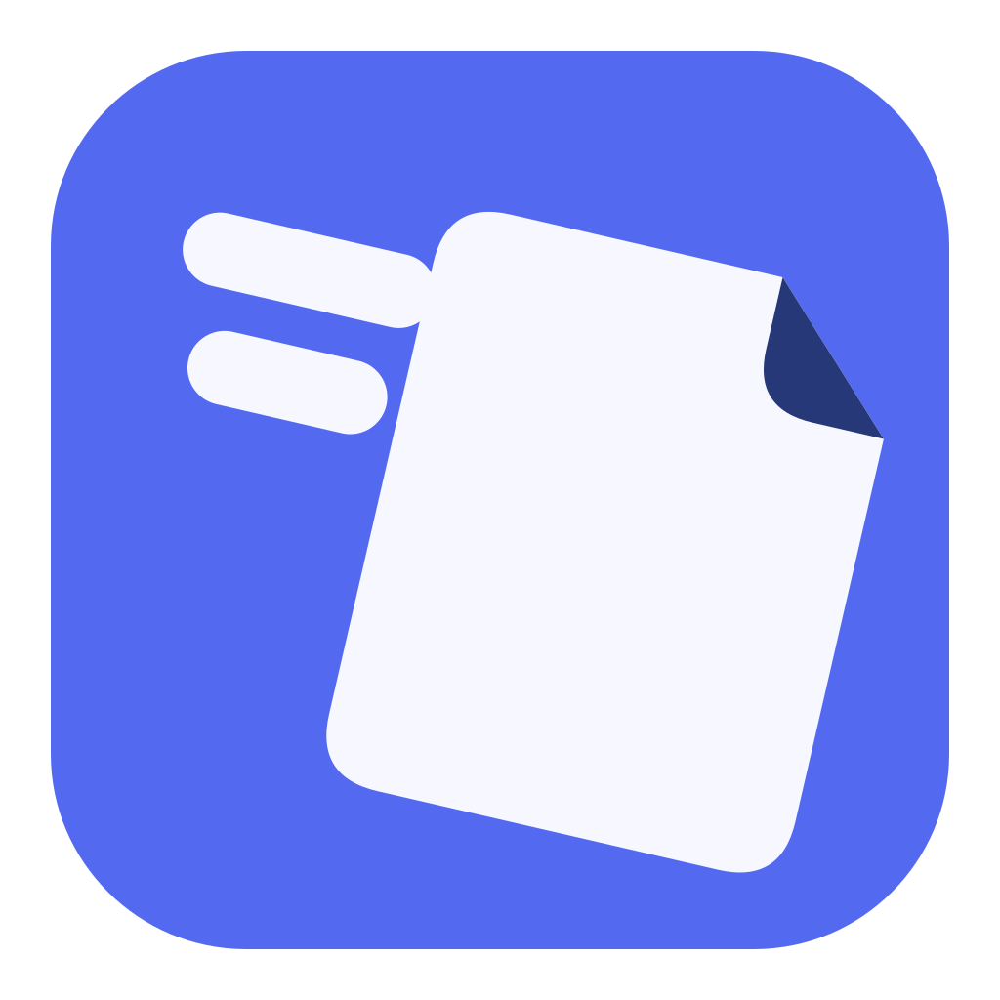

# NimGet



NimGet is a lightweight, open-source download manager built in Go for macOS and Windows. Its `nimget` CLI and background service also run on Linux.

- Up to 32 connections per download, rebalanced as they finish; byte-level resume, even after a crash.
- Queue with priorities, per-host connection caps, speed limits, and a schedule.
- HLS (`.m3u8`, AES-128) to one `.ts` file, optional MP4 conversion with ffmpeg.
- Desktop app: tray icon, notifications, drag and drop, cURL import, clipboard monitor, batch URLs, sleep or shut down when done; English and Simplified Chinese, light and dark themes.
- Chrome and Edge extension with [automatic download capture, manual handoff, and website sessions](docs/browser-handoff.md).

## Install on Windows

The [Windows release guide](docs/windows-release.md) covers the x64 installer, matching Chrome and Edge extension archive, and SHA-256 checksums. See the [Windows installation guide](docs/windows-installer.md) for WebView2, upgrades, and uninstall. Follow the [extension pairing guide](docs/browser-pairing.md) for browser setup.

## Install on macOS

Releases from v1.1.0 include `NimGet-<version>-macos-universal.dmg` for Apple silicon and Intel Macs running macOS 13 or later. Check its hash against `SHA256SUMS-macos.txt` on the release page (`shasum -a 256 NimGet-*.dmg`), open the disk image, and drag NimGet to Applications.

The app is signed ad hoc, not with a paid Developer ID, so macOS blocks the first launch. Open System Settings > Privacy & Security and choose **Open Anyway** for NimGet, or run `xattr -dr com.apple.quarantine /Applications/NimGet.app` once. The browser extension is the same unpacked Chrome and Edge extension as on Windows; download `NimGet-<version>-chromium-extension.zip` from the same release and follow the [extension pairing guide](docs/browser-pairing.md).

## Update NimGet

Published desktop builds check GitHub for stable updates daily by default. Use **Settings → General → Updates → Check now** to check at any time. **Download update** adds the compatible Windows installer or macOS disk image to the queue. NimGet checks its SHA-256 digest before marking the download complete. Quit NimGet and install the downloaded package using the steps for your platform.

## Run from source

Building from source requires Git and Go 1.26+. The desktop app also needs Node.js 22.12+ and, on macOS, the Xcode command line tools. On Windows it needs the WebView2 Runtime.

```bash
git clone https://github.com/amemiya02/nimget.git
cd nimget
```

Run the CLI directly:

```bash
go run ./cmd/nimget download https://example.com/file.iso ./file.iso
```

Run the desktop app (macOS and Windows; `app/` is its own Go module):

```bash
cd app/frontend
npm ci
npm run build
cd ..
go run .
```

For a headless queue, run `go run ./cmd/nimget service` from the repository root and keep that terminal open. In another terminal, use `go run ./cmd/nimget add URL` and `go run ./cmd/nimget list`. The desktop app runs the same service, so these commands also work while it is open. Quit any other NimGet app or service before starting one: they share port 51000 and a single-instance lock.

[docs/source.md](docs/source.md) covers local builds, UI live reload, and updating your checkout. [docs/usage.md](docs/usage.md) covers every command, the settings, and the HTTP API.

## Development

Run `go test ./...` at the repository root and again in `app/`. To build a local CLI for the examples in the usage reference, run `go build ./cmd/nimget` from the repository root; this creates `nimget` (`nimget.exe` on Windows).

After changing a bound Go method or type, regenerate the TypeScript bindings (CI checks them):

```bash
go install github.com/wailsapp/wails/v3/cmd/wails3@v3.0.0-beta.26
cd app && wails3 generate bindings -clean=true -ts -f '-tags production'
```

The design and roadmap are in [DESIGN.md](DESIGN.md); [docs/desktop-checklist.md](docs/desktop-checklist.md) is the manual test list.

## Repository layout

```text
cmd/nimget/             Cobra CLI: service, add, list, set, pause, resume, retry, delete, settings, export, import, download, version
internal/download/    Shared queue model, errors, and event contract
internal/engine/      Download engine: work-stealing ranges, checkpoints, validation
internal/filelock/    OS advisory file locks
internal/logging/     slog setup and URL redaction
internal/store/       SQLite persistence
internal/manager/     Queue, priorities, host caps, limits, schedule, naming, confinement
internal/settings/    Settings document and schedule rules
internal/netproxy/    Manual and system proxy selection
internal/hls/         HLS playlists, AES-128, TS/fMP4 concatenation, segment resume
internal/remux/       Optional ffmpeg remux of .ts to .mp4
internal/batch/       Batch URL patterns
internal/queuefile/   Queue import and export
internal/power/       Sleep and shut down
internal/update/      Stable release checks and update package selection
internal/quarantine/  Marks completed files as downloaded from the internet
internal/secrets/     AES-GCM sealing with a key in the OS keyring
internal/curlimport/  "Copy as cURL" parser
internal/api/         Authenticated loopback JSON and SSE API
internal/client/      Service client
internal/service/     Service composition, lifecycle, paths, and token
tools/bench/          Performance gate against aria2c
docs/                 Source startup guide, usage reference, desktop checklist
app/                  Desktop app (Wails v3 module): bindings, tray, React frontend
DESIGN.md             Design contract and M0–M6 roadmap
```

## License

Apache-2.0. See [LICENSE](LICENSE) and [NOTICE](NOTICE).
