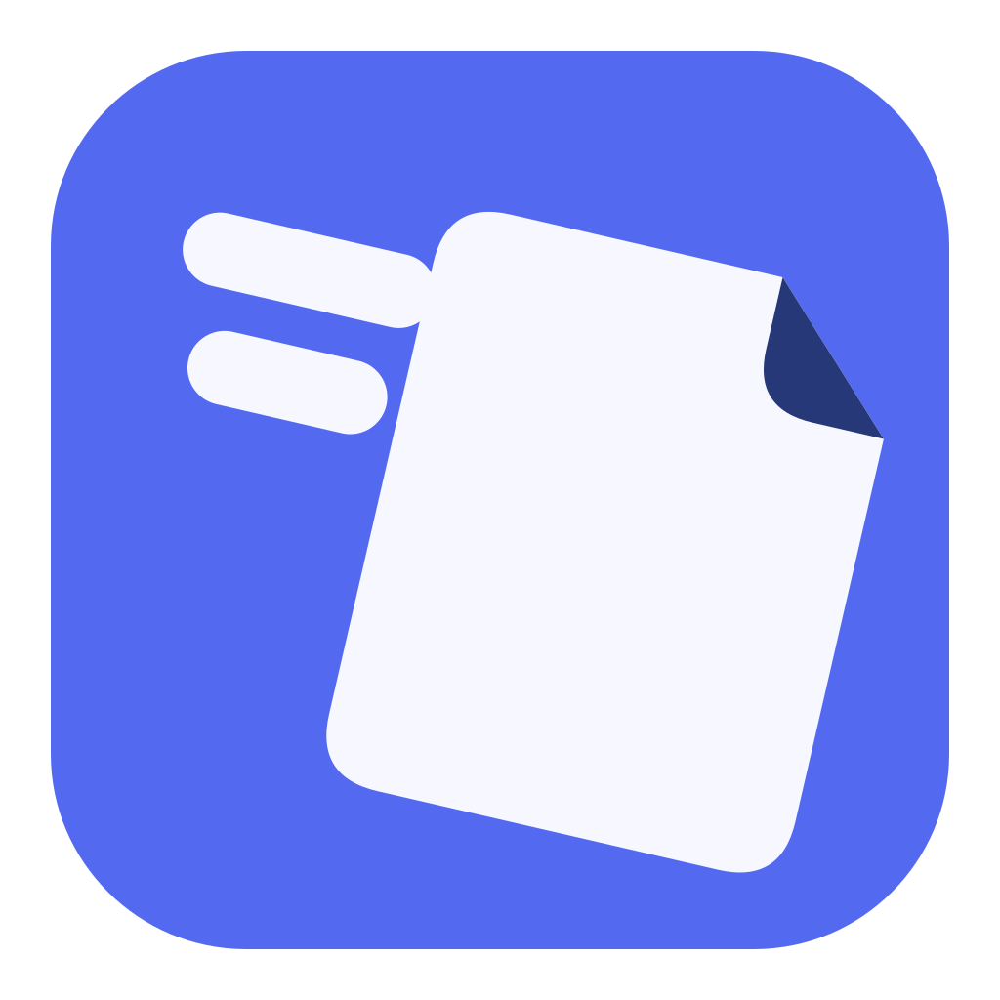
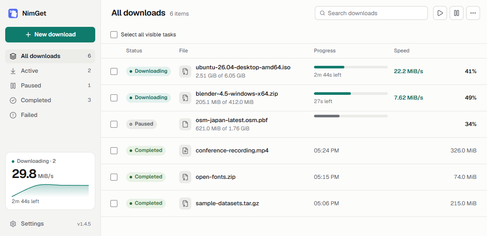

<p align="center">
  
</p>

<h1 align="center">NimGet</h1>

<p align="center">适用于 Windows 和 macOS 的开源下载管理器。命令行工具和后台下载队列也支持 Linux。</p>

<p align="center">
  <a href="https://github.com/amemiya02/nimget/releases/latest"></a>
  <a href="https://github.com/amemiya02/nimget/actions/workflows/ci.yml"></a>
  <a href="LICENSE"></a>
</p>

<p align="center">
  <a href="https://github.com/amemiya02/nimget/releases/latest"><strong>下载 NimGet</strong></a>
  · <a href="#性能基准">性能基准</a>
  · <a href="docs/usage.md">使用文档</a>
</p>

<p align="center"><a href="README.md">English</a> · <strong>简体中文</strong></p>



<p align="center"><sub>桌面预览使用示例下载任务</sub></p>

- **多连接 HTTP 下载。** 单个文件最多使用 32 个连接，连接完成后会重新分配剩余工作。符合条件的下载在程序崩溃后可从已保存的字节位置续传。
- **管理下载队列。** 设置任务优先级、每台服务器的连接上限、下载限速和运行时段。
- **接管浏览器下载。** 从 Chrome 或 Edge 手动发送下载链接，也可以启用自动接管。下载需要登录时，可使用浏览器中已有的网站会话。[浏览器集成](docs/browser-handoff.md)
- **支持磁力链接和 HLS。** 下载公开的 BitTorrent v1、v2 和混合格式磁力链接，也能保存受支持的 HLS 流，并通过 FFmpeg 转换为 MP4。[支持的下载类型](docs/usage.md)

## 性能基准

在 Windows 11 上的两组本地回环测试中，NimGet 每组连续五轮都领先。下载 512 MiB 的不限速文件时，吞吐量是 **aria2 的 3.2 倍**、**Windows curl 的 4.9 倍**。

| 测试场景 | NimGet | Windows curl | aria2 |
| --- | ---: | ---: | ---: |
| 512 MiB，不限速。NimGet 使用 8 个连接，aria2 使用 16 个。 | **1.24 秒** | 6.14 秒 | 3.97 秒 |
| 64 MiB，每连接限速 4 MiB/s，响应延迟 350 ms。NimGet 和 aria2 均使用 6 个连接。 | **3.52 秒** | 16.39 秒 | 4.11 秒 |

表中是五轮下载完成时间的中位数。每轮都用 SHA-256 校验文件，之后删除测试产物。公网下载速度因下载源和网络而异。[完整结果与复现命令](docs/http-benchmarks.md)

## Windows 安装

从[最新发行版](https://github.com/amemiya02/nimget/releases/latest)下载 x64 安装程序和 `SHA256SUMS.txt`。NimGet 支持安装了 WebView2 Runtime 的 Windows 10 和 11。[安装与校验指南](docs/windows-installer.md)

## macOS 安装

从[最新发行版](https://github.com/amemiya02/nimget/releases/latest)下载通用 DMG 和 `SHA256SUMS-macos.txt`。NimGet 支持运行 macOS 13 或更高版本的 Apple 芯片和 Intel Mac。

运行 `shasum -a 256 NimGet-*.dmg`，将结果与校验文件对比。打开镜像后，把 NimGet 拖入「应用程序」。若 macOS 阻止首次打开采用临时签名的应用，请在 **系统设置 → 隐私与安全性** 中选择 **仍要打开**。

## 快速开始

1. 打开 NimGet，选择 **新建下载**，粘贴 HTTP(S) URL 或磁力链接。
2. 若要从 Chrome 或 Edge 接管下载，请从同一发行版下载 Chromium 扩展 ZIP，并[将扩展与 NimGet 配对](docs/browser-pairing.md)。
3. 在侧栏选择 **检查更新** 可查看桌面版的新版本。下载更新时，NimGet 会在安装包进入已完成列表前验证校验和。

## 从源码运行

在 Windows、macOS 或 Linux 上运行命令行工具需要 Git 和 Go 1.27 或更高版本。

```sh
git clone https://github.com/amemiya02/nimget.git
cd nimget
go run ./cmd/nimget download https://github.com/amemiya02/nimget/releases/latest/download/SHA256SUMS.txt ./nimget-checksums.txt
```

使用 `go run ./cmd/nimget service` 启动后台下载服务，然后在另一个终端用 `go run ./cmd/nimget add URL` 添加任务、用 `go run ./cmd/nimget list` 查看队列。桌面应用运行时，也可以使用这两个命令。

桌面版还需要 Node.js 22.12 或更高版本，以及[源码指南](docs/source.md)中的平台依赖。

```sh
cd app/frontend
npm ci
npm run build
cd ..
go run .
```

## 参与贡献

分别在仓库根目录和 `app/` 目录运行 `go test ./...`。开发流程见[源码指南](docs/source.md)，手动验证步骤见[桌面版检查清单](docs/desktop-checklist.md)，引擎与架构见 [DESIGN.md](DESIGN.md)。

## 许可证

项目采用 [Apache-2.0](LICENSE) 许可证。第三方声明见 [NOTICE](NOTICE)。
